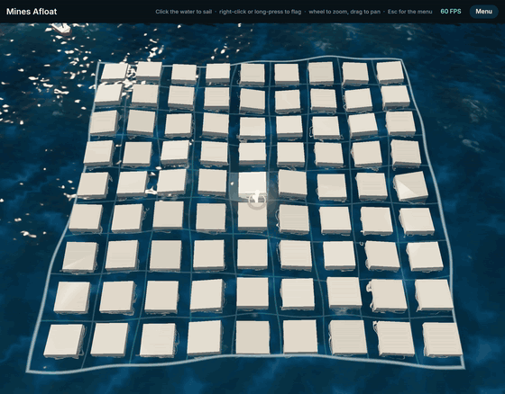
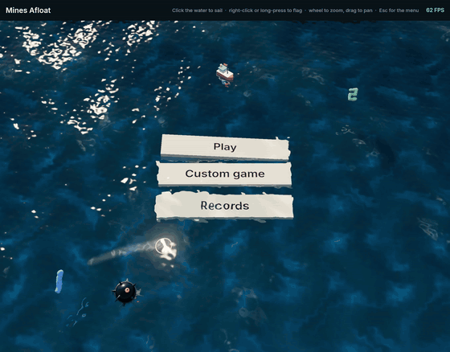

# Mines Afloat

[](https://github.com/pockerhead/rune-minesweeper/actions/workflows/ci.yml)
[](https://pockerhead.github.io/rune-minesweeper/)
[](https://github.com/pockerhead/rune-minesweeper/releases/latest)
[](https://pockerhead.goatcounter.com/)
[](https://github.com/pockerhead/rune-minesweeper/releases)
[](LICENSE)
[](https://pockerhead.github.io/rune-minesweeper/)
[](https://github.com/anomalyco/rune)
[](https://github.com/pockerhead/oxijolt)
[](https://www.rust-lang.org/)

**Minesweeper on a living sea.** The board floats. A tiny boat sails the channels between the tiles to every cell you open, the tile melts into the water in front of its bow, and if there is a mine underneath, the boat makes it to the middle and goes up in a ball of fire. The numbers hang above the water as little volumetric clouds that cast shadows and show up in the reflections.



It is a native app in Rust, built on **[Rune](https://github.com/anomalyco/rune)**, a GPU-rendered UI framework, with **[oxijolt](https://crates.io/crates/oxijolt)** (Jolt Physics) floating every tile, mine and splinter on the waves. One window, one wgpu device: Rune draws the interface and hands the 3D world a slot in its own frame.

## Play in the browser

**[pockerhead.github.io/rune-minesweeper](https://pockerhead.github.io/rune-minesweeper/)**: the same app compiled to WebAssembly, Jolt and all. It needs WebGPU, which means a recent Chrome or Edge, Safari 26, or Firefox 141+ on Windows.

## Download

Grab a build for Windows, Linux (x86_64, and aarch64 for a Raspberry Pi 5) or macOS from [Releases](https://github.com/pockerhead/rune-minesweeper/releases).

Every file comes with a SHA-256 checksum and a signed build-provenance attestation, so you can check that a binary was built by this repository's GitHub Actions from a given commit:

```sh
gh attestation verify mines-afloat-v0.2.0-macos-arm64.tar.gz --repo pockerhead/rune-minesweeper
```

macOS builds are not notarised yet. After unpacking, clear the quarantine flag once:

```sh
xattr -d com.apple.quarantine mines-afloat
```

## Play

- **Click a cell** to send the boat. It finds its way along the channels, the tile melts, and the numbers puff up as clouds.
- **Right-click**, or **long-press** on a touch screen, to plant a flag.
- **Esc** goes back to the menu.
- Move the cursor over the water: it is a little light that drags a foam wake behind it.

Levels are the classic ones: Beginner (9 × 9, 10 mines), Intermediate (16 × 16, 40), Expert (30 × 16, 99). There is also a custom game up to 30 × 16, and best times are kept per level.

The menu is part of the world too. Its items are floating tiles, and picking one blows it up like a mine while the rest melt and the next menu surfaces. You can sail the boat anywhere in it, and there is a mine adrift out there if you feel like testing that.



## How it is made

| Piece | What it does |
|---|---|
| **Rune compositor hook** | Rune builds the frame and calls back at an `El::effect` slot. The game renders its 3D scene into its own offscreen targets first, then blits it into that slot, so the 3D board sits in the layout like any other element. Menu labels and the end banner are ordinary Rune text placed over the world. |
| **Water** | Four Gerstner waves on the GPU, plus an interactive 160 × 160 heightfield solved on the CPU every step (a wave equation with a little viscosity). The cursor, splashes and falling debris push into it. Foam is a decaying field laced with a caustics pattern. |
| **Refraction and absorption** | The opaque scene is copied after its pass and the water reads it back through its normal, attenuated along the view ray (Beer–Lambert), so things under the surface fade to dark blue-green with depth. |
| **Reflections** | Screen-space reflections against the depth buffer for tiles, the boat and mines; the clouds are ray-traced into the reflection. |
| **Number clouds** | Signed distance fields: seven-segment strokes swept into fat tubes and roughened with 3D noise, lit with wrapped sun, sky fill, ambient occlusion and a silver lining. Rays find them with a 2D DDA over the cell grid, so a full Expert board costs about the same as a small one. They cast soft shadows on the water and tiles. |
| **Physics** | oxijolt (Jolt 5.6). Every tile is a dynamic body with buoyancy against the same wave function the shader uses, plus the ripples, a soft spring to its cell and a torque that keeps it square. Mines, the wrecked boat and blown-up menu tiles are bodies too. |
| **The boat** | Animated, not simulated, and following Disney's principles. It anticipates before it sets off and eases in and out. It rocks theatrically, banks into turns and dips its nose when it brakes. Mast and flag follow through on looser springs, and the hull squashes and stretches on the swell. |
| **Image** | HDR offscreen and ACES tonemapping. The render scale follows the frame time: 2× supersampling where the GPU has room, down to a third of native resolution on a phone, with the costliest shader loops shortened to match. |

About 5,000 lines of Rust and WGSL, with 33 tests for the rules, the water, the boat routes and the menu world. Rune's headless tooling renders to PNG or video from scripted input, and it was used to check every change. The GIFs above came out of it.

## Browser build

`web/build.sh` builds the wasm version into `web/dist`. It needs the `wasm32-unknown-unknown` target, `wasm-bindgen-cli` at the version in `Cargo.lock`, and `WASI_SDK_PATH` pointing at wasi-sdk 34: oxijolt compiles Jolt for the browser with it. The `pages` workflow does the same on every push to `main` and publishes the result.

## Build from source

You need a recent stable Rust, and on Linux the usual windowing headers:

```sh
sudo apt-get install pkg-config cmake libxkbcommon-dev libwayland-dev libx11-dev libxcursor-dev libxrandr-dev libxi-dev libvulkan-dev
```

Then:

```sh
cargo run --release
```

Rune is pre-release, so `Cargo.toml` pins a revision of it. It also patches a few crates (wgpu-hal, winit, parley_engine and the AccessKit adapters) with Rune's own versions, straight from its repository, as Rune asks of every app built on it.

Headless runs work as in any Rune app, for example:

```sh
cargo run --release -- --snap shot.png --at 3 --size 1280x800 --scene expert
```

## Layout

```
src/main.rs      screens, menu, input, the compositor that ties Rune and the 3D world together
src/scene.rs     turns the game or the menu world into instances and shader uniforms
src/sea.rs       what both worlds share: physics, water, the boat, debris, blasts
src/game.rs      the rules and board sizes
src/lobby.rs     the menu's world
src/records.rs   best times, in the platform's data folder
src/boat.rs      routing through the channels and the boat's animation
src/ripple.rs    the interactive water
src/gfx.rs       wgpu passes, meshes, instancing
src/shaders/     WGSL: water, lit meshes, clouds, blit
```

## Credits

- **[Rune](https://github.com/anomalyco/rune)** by Anomaly: the UI framework, the compositor hook that made a game possible inside it, and the headless tooling that checked every frame.
- **[oxijolt](https://github.com/pockerhead/oxijolt)**: safe Rust bindings to [Jolt Physics](https://github.com/jrouwe/JoltPhysics), on the desktop and in the browser.
- **[rust_gamedev_ru](https://t.me/rust_gamedev_ru)**. On a lazy Sunday someone in that Telegram chat asked another AI to "build me a simple minesweeper with Rune", got a flat one ([minesweeper_rune](https://github.com/madwareru/minesweeper_rune)), and the thread wished out loud for "the field as a sea with a pretty shader" and "mines with buoyancy physics", then concluded that was a lot to ask of a library meant for app UIs. Fair point. This is the reply, with warmth and a little irony, to everyone in that thread.

## License

MIT. Rune and oxijolt are MIT licensed by their authors; Jolt Physics is MIT.
